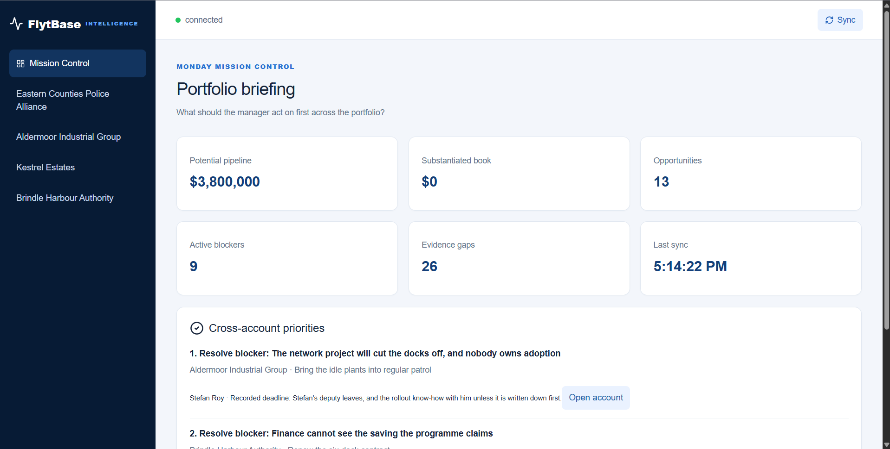
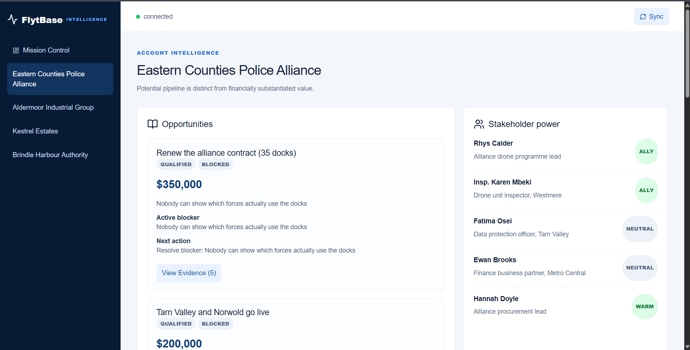
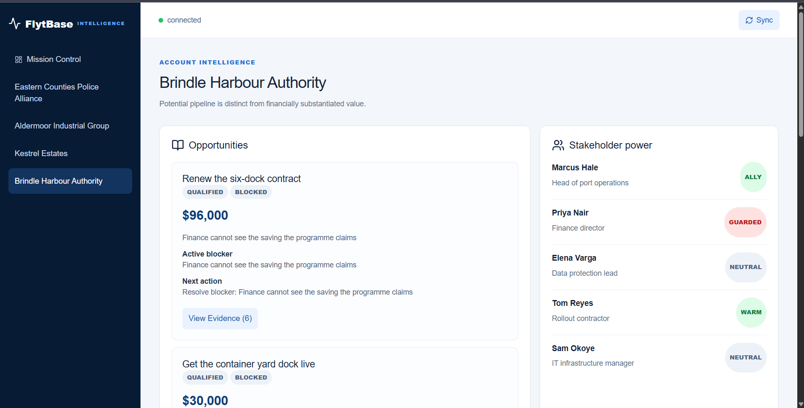
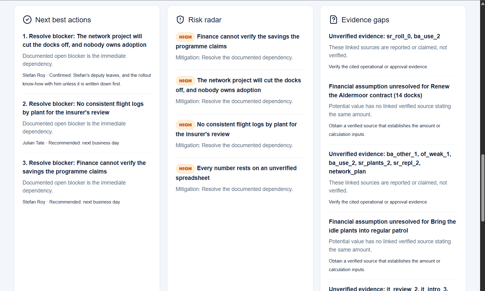
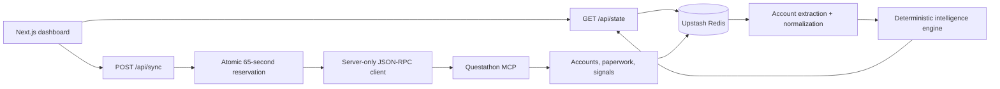
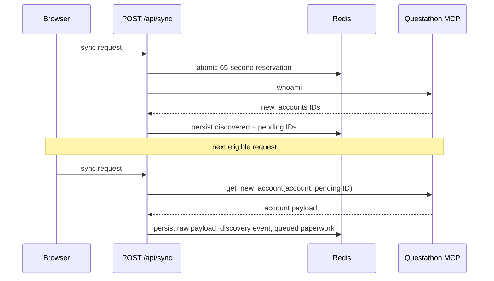

# FlytBase Account Intelligence

**Evidence before forecast.** A decision-support CRM that turns account records, evidence, stakeholders, blockers, and deadlines into traceable commercial actions.

[Live application](https://flytbase-account-intelligence-6cpfokce5-valerian1.vercel.app/) · [Repository](https://github.com/ayushxt25/flytbase-account-intelligence)

`Next.js 15` `TypeScript` `Tailwind CSS` `Upstash Redis` `MCP JSON-RPC`

Enterprise account managers rarely need another contact list. They need to know what is commercially defensible, who can move a deal, what dependency is stopping progress, and which source supports that conclusion. FlytBase Account Intelligence consolidates the Questathon account feed into a portfolio briefing and account-level decision surface for Eastern Counties Police Alliance, Aldermoor Industrial Group, and any subsequently released accounts.

It answers five operational questions:

1. What is the account commercially worth?
2. Who influences the decision?
3. What should the account manager do next?
4. What risks threaten progress?
5. What remains missing or unverified?

## Screenshots

### Mission Control



*Cross-account pipeline, substantiated book, blockers, evidence gaps, and prioritized portfolio actions.*

### Account intelligence



*Opportunity readiness, commercial value, evidence access, and the stakeholder power map for Eastern Counties Police Alliance.*



*The same evidence-driven account workflow applied to a dynamically added account.*

### Decision execution



*Action ranking, deal-specific risks, and explicit evidence gaps keep the decision trail visible.*

## Core capabilities

| Capability | Implemented behavior |
|---|---|
| Mission Control | Aggregates potential pipeline, substantiated book, opportunities, active blockers, gaps, last sync, and the top three cross-account actions. |
| Commercial assessment | Keeps `worth_up_to` as potential pipeline. A value enters the substantiated book only when linked verified evidence states the same monetary amount. |
| Evidence model | Facts retain source ID, status (`verified`, `told`, `claim`, `unknown`), supplier where available, and raw source material for inspection. |
| Decision engine | Deterministically ranks blocker, deadline, evidence-readiness, and progression actions; it is not an ML model or autonomous agent. |
| Lifecycle intelligence | Open blockers create risks and actions; cleared blockers do not. Met deadlines do not become missed-deadline risks. |
| Readiness | Each opportunity is assessed as BLOCKED, EVIDENCE INCOMPLETE, READY FOR REVIEW, or UNKNOWN without treating missing information as readiness. |
| Dynamic accounts | `whoami` discovers released account IDs; queued `get_new_account({ account: id })` calls import valid accounts into the same pipeline. |
| Secure write-back | `POST /api/notes` requires `x-admin-secret`, shares the upstream cooldown, and calls MCP `write_note` only server-side. |

## Architecture



The browser reads cached state every 20 seconds; it does not call MCP directly. API routes trigger eligible synchronization, while Redis stores raw payloads, derived state, event history, and the shared reservation. Normalization preserves source records and IDs; the intelligence layer derives readiness, actions, risks, gaps, and conservative valuation.

## Dynamic account discovery and synchronization

Released accounts are not hardcoded. The synchronizer uses one upstream request per eligible cycle:



`get_new_account` is called with an account ID discovered from `whoami`. Responses are accepted only when the shared extractor finds a structurally valid account record; empty or malformed responses leave the ID pending and persist only a safe structural diagnostic. Account records are deduplicated by source ID. Original exports, additional raw payloads, files, paperwork, and signals are retained across refreshes. Discovery is revisited periodically for future releases.

## Decision intelligence and evidence model

Facts are classified as **verified**, **told**, **claim**, or **unknown**. An opportunity can reference facts or documents by source ID; the evidence inspector presents the held statement and raw record separately from the system’s interpretation.

The valuation safeguard is intentionally narrow: a verified operational fact does not validate an opportunity’s full `worth_up_to`. The engine requires linked verified evidence that explicitly states the same amount before including it in the substantiated book. Agreement stage also does not, by itself, prove a financial assumption. Otherwise the value remains potential pipeline and an explicit financial-evidence gap is shown.

Open blocker records generate deal-specific risks and resolution actions. Cleared blocker records remain historical lifecycle information rather than active risk. Deadlines use supplied `passed`, `met`, and `soon` metadata where present; descriptive text is not presented as a fabricated calendar date. Actions are ranked deterministically by documented blockers, recorded urgency, missing evidence, readiness, and commercial potential, with stable tie-breaking.

## Verified development snapshot

**14 November 2026 local development snapshot** — values are data-dependent, not application constants, and can change after synchronization.

| Metric | Snapshot |
|---|---:|
| Accounts | 4 |
| Opportunities | 13 |
| Potential pipeline | $3,800,000 |
| Financially substantiated book | $0 |
| Active blockers | 9 |
| Evidence gaps | 26 |

Accounts: Eastern Counties Police Alliance, Aldermoor Industrial Group, Kestrel Estates, and Brindle Harbour Authority.

## Technology stack

| Technology | Role |
|---|---|
| Next.js 15 / React 19 | App Router dashboard and Vercel-compatible server routes |
| TypeScript 5 | Typed normalization, state, and deterministic decision rules |
| Tailwind CSS 4 | Base styling, alongside application CSS |
| Lucide React | Interface icons |
| Upstash Redis | Persistent state and atomic distributed cooldown |
| MCP over JSON-RPC | Server-side Questathon data and note write-back |

## Application API

| Endpoint | Method | Purpose | Access |
|---|---|---|---|
| `/api/state` | GET | Cached normalized accounts, intelligence, events, and sync state | Public read |
| `/api/sync` | POST | Executes at most one cooldown-protected MCP operation | Public trigger; upstream guarded |
| `/api/notes` | POST | Calls MCP `write_note` | `x-admin-secret` required |
| `/api/health` | GET | Safe configuration/operational status | Public read |

MCP bearer credentials remain in server-side environment variables and are never returned by these routes.

## Local setup

### Prerequisites

- Node.js 20+ recommended
- An Upstash Redis REST database
- Questathon MCP credentials

```powershell
git clone https://github.com/ayushxt25/flytbase-account-intelligence.git
cd flytbase-account-intelligence
npm install
Copy-Item .env.example .env.local
```

Set placeholder values in `.env.local`:

| Variable | Purpose |
|---|---|
| `AQ_TOKEN` | Server-side Questathon MCP bearer token |
| `UPSTASH_REDIS_REST_URL` | Redis REST endpoint |
| `UPSTASH_REDIS_REST_TOKEN` | Redis REST credential |
| `ADMIN_SECRET` | Required by the note write-back route |

```powershell
npm run dev
# http://localhost:3000
npm run typecheck
npm run build
npm run start
```

## Reliability, security, and operations

- **One upstream request per eligible sync:** Redis `SET NX EX 65` provides the shared reservation for reads and writes.
- **Cached reads:** dashboard polling consumes `/api/state`; temporary upstream failure retains cached state and marks it stale.
- **Duplicate prevention:** signal events use stable IDs when supplied, otherwise a deterministic fingerprint; accounts use source IDs.
- **Defensive extraction:** account payloads can be bare, arrays, or nested in `account`, `accounts`, `new_account`, `new_accounts`, `data`, or `result`.
- **Failure recovery:** an unrecognized additional-account response does not mark ingestion complete, so discovery/download can retry later.
- **Restricted mutation:** notes require the admin secret and the same cooldown; the route does not mutate derived account intelligence itself.

## Engineering decisions

### Dynamic MCP integration debugging

The original export and newly released accounts use different access patterns. Investigation established that `whoami` exposes released IDs while `get_new_account` requires `{ account: id }`. The implementation therefore separates discovery from download, persists pending IDs, retrieves one account per eligible sync, validates the returned account shape, and merges only by source ID. This avoids both speculative account creation and loss of already imported records when the original export is refreshed.

### Evidence is a product constraint

The dashboard deliberately favors an explicit gap over a confident-looking but unsupported forecast. This affects valuation, action ownership, blocker status, and readiness: missing or unverified evidence is surfaced as uncertainty rather than silently treated as a positive signal.

## Testing and verification

Available commands are `npm run typecheck`, `npm run lint`, and `npm run build`. The repository currently has no committed automated test suite or CI configuration, so no test counts or coverage claims are made here. Manual verification should cover account discovery sequencing, source inspection, cached state, cooldown behavior, and note-route authorization using non-production credentials.

## Limitations and next steps

This MVP does not independently authenticate customer statements, predict win probability, provide role-based collaborative access, or reconcile arbitrary live signals into authoritative account facts. Financial substantiation is limited to evidence held in the available records and deliberately does not infer values from technical evidence. Natural extensions include more complete multi-source financial calculations, richer event reconciliation, and automated regression tests around MCP response variants.

## Context and authorship

Created for **FlytBase Questathon 2026** by **Ayush Kumar Giri** ([GitHub](https://github.com/ayushxt25)). ChatGPT and OpenAI Codex assisted with implementation and debugging; engineering decisions were checked against the application’s data flow and observed integration behavior.
